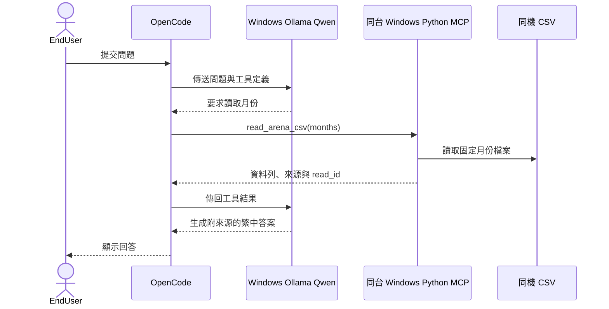

# 臺北小巨蛋 CSV 題庫與 Windows Qwen 驗收

EndUser 在自己的電腦使用 OpenCode。OpenCode 向 Windows Ollama Qwen 送出問題，收到工具呼叫後連到同一台 Windows 上的唯讀 MCP，再把工具結果交回 Qwen。原始 CSV 留在 Windows，查詢結果會經過 OpenCode。

## 題庫

每題先貼共用 Prompt，再貼表內該題的 Prompt。

> 請使用臺北小巨蛋場地租用資料集工具查詢。僅依工具結果以繁體中文回答，附上來源檔名或資料涵蓋月份。計算租期時包含起訖日。若資料不足或工具失敗，請說明原因。

來源檔名使用 `臺北小巨蛋場地租用資訊_YYYYMM.csv`，1 月使用 `臺北小巨蛋場地租用資訊_202601_V2.csv`。行號從表頭第 1 行起算。Q1、Q2 是展示候選。

| 情境 | Prompt | 標準答案與來源 | Windows 驗收 |
|---|---|---|---|
| **Q1 · 客服查詢** | 查詢 `2026Energy演唱會` 的廠商、活動類型和租用起訖日。 | 用心音樂國際有限公司，娛樂，2026/1/5–1/11。1 月 `_V2` 第 3 行。 | 未驗證 |
| **Q2 · 跨月排程** | 查詢 `2026台北羽球公開賽` 的廠商，列出各段租期、各段天數和合計天數。 | 中華民國羽球協會。7/25–7/31 共 7 天，8/1–8/3 共 3 天，合計 **10 天**。7 月第 5 行、8 月第 2 行。 | 未驗證 |
| **Q3 · 主管月報** | 按 1–10 月各月檔的原始資料列逐列計數，列出各類型筆數、總筆數和筆數最多的月份。 | 娛樂 33、集會 11、體育 9、藝文 3，共 **56 筆**。10 月最多，共 8 筆。來源為全部 10 檔。 | 未驗證 |
| **Q4 · 場務重疊檢查** | 找出 8 月至少有兩筆租用紀錄涵蓋的日期，列出各日的筆數與活動名稱。 | **8/9、8/10 各兩筆**。兩天均為 `2026許富凱 台北小巨蛋演唱會` 和 `八三夭沒有翅膀的人世界巡迴演唱會`。8 月第 3、4 行。 | 未驗證 |
| **Q5 · 檔期初查** | 找出 7 月未被任何租用紀錄涵蓋的日期區間及總天數，說明能否確認可租。 | **7/6–7/12、7/21–7/24，共 11 天**。實際可租性待確認。7 月第 2–5 行。 | 未驗證 |
| **Q6 · 資料範圍判斷** | 先確認資料涵蓋期間，再回答 2026/11/14–11/15 是否有租用紀錄、是否可租。 | 涵蓋 1–10 月，11 月缺檔，無法判定有無租用紀錄或是否可租。來源為 MCP 回傳的月份清冊。 | 未驗證 |

## 安裝與重跑

在 Mac 和 Windows 都從 `poc/arena-csv/` 執行 `uv sync --locked`。共用 `pyproject.toml` 和 `uv.lock`。本版鎖定官方 `mcp` 1.30.0，使用 SDK 內建的 `FastMCP`。若日後遷移至 2.x，對應介面是 SDK 的 `MCPServer`。 [uv 鎖定與同步](https://docs.astral.sh/uv/concepts/projects/sync/) · [MCP SDK 遷移指南](https://github.com/modelcontextprotocol/python-sdk/blob/main/docs/migration.md)

- **服務端。** 設定 `ARENA_CSV_DATA_DIR` 為原始十檔所在的絕對路徑，並透過執行環境注入專用 `ARENA_CSV_MCP_TOKEN`。以唯讀資料帳號執行 `uv run --locked python -X utf8 server.py`。服務監聽 `127.0.0.1:8765/mcp`。Windows 跨機驗證使用已獲准的內網 HTTPS 路徑，轉發至這個 loopback 端點並保留 Authorization 標頭。上游 Host 使用 `127.0.0.1:8765`，以符合 SDK 的 loopback Host 檢查。
- **MCP 客戶端。** 設定 `ARENA_CSV_MCP_URL` 與對應的 `ARENA_CSV_MCP_TOKEN`，執行 `uv run --locked python -X utf8 probe_mcp.py`。它會用官方 SDK 列出工具並查詢 1 月、7 月加 8 月、11 月，再核對非法月份、額外路徑參數及 HTTP 401。可先在服務主機用 `http://127.0.0.1:8765/mcp`，再以 EndUser 的獲准內網 URL 分開測試。
- **EndUser OpenCode。** 範本採 OpenCode 1.19.5 設定格式。在乾淨工作區複製 `opencode.example.json` 為 `opencode.json`。設定 `ARENA_OLLAMA_BASE_URL` 為同一台 Windows 的獲准 Ollama URL，結尾為 `/v1`。再設定遠端 MCP URL 與 token。用 `opencode mcp list` 確認連線，選 `ollama/qwen3.5:9b` 並逐題開新 session。若主機的核准 tag 不同，同步更新範本的模型表、主模型與小模型。工作區只放設定和要送出的 Prompt，原始 CSV 與標準答案由服務端及驗證端分開持有。

`read_arena_csv` 只接受 2026 年月份清單。回傳 `available_months`、`missing_months`、原始五欄與各列 `source_file`／`source_line`，以及 `read_id`。預期來源遺失或所查檔案無法解析時回報資料不完整。服務紀錄以 `read_id` 對應月份、來源檔名及筆數。

## 分階段驗證

| TestCase | 步驟與證據 | 本輪結果 |
|---|---|---|
| **TC-01 · Mac 自驗** | 先用 Python `csv`、`datetime` 從原始十檔重算六題，逐檔保存 SHA-256。再用 `uv run --locked` 啟動同一份 Python MCP，由 MCP 客戶端直接查 7、8 月及 11 月。 | 2026-11-23 已重算六題，總列數為 56。已核對 7 月 4 筆、8 月 6 筆及逐列來源。11 月回報未涵蓋且為空列。另通過 6 項 Python 測試，OpenCode 1.19.5 的 `mcp list` 也已用範本連到 Mac 測試服務。 |
| **TC-02 · Windows 本機分驗** | 以 `Get-FileHash -Algorithm SHA256` 比對 Windows 十檔。執行 MCP probe 並核對 Windows 服務紀錄。另用 `/api/tags`、`/api/show` 和短推論記錄本機 Ollama 版本、Qwen tag、digest 與工具能力。 | 未驗證。待取得同機 Windows 執行環境、來源副本及 MCP 端點。 |
| **TC-03 · EndUser 跨機分驗** | 從獲准客戶端先對 Windows Qwen 做短推論，再獨立執行遠端 MCP probe，對照同一台主機的服務紀錄。 | 未驗證。待 TC-02 與內網連線。 |
| **TC-04 · 主秀串接** | Q1、Q2 各用全新 OpenCode session。保留 OpenCode 的工具呼叫與回傳、對應的 Windows Ollama 請求、同機 MCP 的 `read_id` 與 CSV 讀取紀錄，以及最終答案。 | 未驗證。待 TC-03。 |
| **TC-05 · 其餘題目與負向驗證** | 同路由跑 Q3–Q6，核對非法月份、額外路徑及未授權拒絕。以獨立客戶端停用 MCP，確認模型會說明無法查證。 | Mac probe 已驗證非法月份、額外路徑和 HTTP 401。正式 Windows 案例待驗。 |

每題交付狀態為通過、失敗或未驗證。正式通過需同時核對答案，以及 EndUser OpenCode 經同台 Windows Qwen 與 MCP 實際讀取同機 CSV 的證據。鏈路尚未證實時暫停依賴它的案例。鏈路證實後，個別答錯照實記錄，續驗其他題目。Q1、Q2 各自通過才列為可展示。

## python-implementation 工作契約

| 欄位 | 本 topic 邊界 |
|---|---|
| `In-Scope` | Windows 唯讀 CSV MCP、OpenCode 設定範本、六題題庫、分階段驗證及本機審查圖件。 |
| `Out-Of-Scope` | 舊 POC 重構、全庫建圖、全域工具設定、公司網路政策變更、發布與合併。交付流程為 topic commit、push、Draft PR，再交人工審查。 |
| `ReadOnly` | 原始 CSV、既有 Excel 與 tinyllama 流程及歷史證據、既有 GitHub 與忽略設定、技能和工具 runtime。 |
| `Written` | 新增 Python MCP、OpenCode 設定範本、專用測試、題庫，以及供 Mac 和 Windows 共用的 `pyproject.toml`、`uv.lock`。原始收證與圖件存 repo 外。 |
| `Deleted` | 無。 |
| `Modify` | 本 topic 新增的實作、設定範本、測試與題庫。 |
| `Goal` | 確認 EndUser OpenCode 能透過同一台 Windows 上的 Qwen 與 MCP 查詢原始 CSV，產出可核對的繁中答案。 |
| `Non-Goal` | 通用資料服務、場地預約、雲端推論及模型比較。 |
| `TestCase` | TC-01 的 Mac 校算與 MCP 直呼，以及 TC-02 至 TC-05 的 Windows 同機讀檔與 EndUser 跨機驗收。 |
